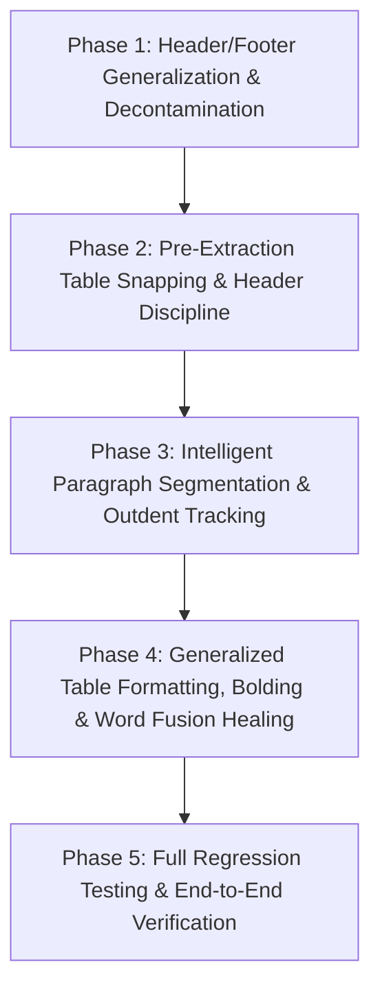

# Plan 04: Document Generalization, Table Boundary Snapping & Typography Integrity Plan

## 1. Executive Objective
Transition the document conversion pipeline from brittle, document-specific hardcoding to **robust, generalized computer-vision and structural heuristics**. 

This plan directly resolves the 6 discrepancy categories identified across the full document and comparison screenshots while providing a **100% regression-free guarantee** for all previously achieved accounting table and document fidelity milestones.

---

## 2. Issues to Resolve & Target Outcomes

| Issue / Screenshot | Description | Root Cause | Target Outcome |
| :--- | :--- | :--- | :--- |
| **Screenshot 1** | Question 24 item `(i)` missing near bottom of page. | Blind static cutoff `y0 > 0.90 * h` deleted valid question text. | Model-driven header/footer detection: suppress only genuine footers; preserve 100% of problem text. |
| **Screenshot 2** | Missing newline before *"Determine the amount of purchase consideration..."*. | Static `22px` gap check failed ($16\text{ px} \le 22\text{ px}$); horizontal outdent ($\Delta x_0 = -59\text{ px}$) ignored. | Multi-signal paragraph segmentation: triggers on margin outdent ($\Delta x_0 < -25\text{ px}$) and dynamic line gap. |
| **Screenshot 3 & 4** | Question 2 table inflated from 7 to 15 rows: lead-in sentence became shaded header, trailing bullet points (i)–(iv) became table rows. | Candidate bounding box from neural layout was oversized; tokens were not snapped to physical table ruling lines. | Pre-extraction morphological line snapping in `convert.py`: isolates the genuine 7-row table and leaves narrative text in paragraph flow. |
| **Screenshot 5** | Missing newline between Note 1 and Note 2. | `is_new_list` regex only checked parentheses `\([0-9a-z]+\)`, missing standard decimal numbering `1.`, `2.`. | Generalized list detection supporting `\d+\.`, `\d+\)`, `[a-zA-Z]\.`, Roman numerals, and bullet glyphs. |
| **Screenshot 6** | Category heads (`Sundry Assets`, `Share capital:`) missing bold; bullet (iv) falsely bolded with a total border. | `is_table_cell_bold` lacked structural role detection; last row was unconditionally treated as a total row. | Structural table role classification (category heads = bold, total line only on verified financial totals). |
| **OCR Word Fusion (Audit)** | `CashreceivedfromTradereceivables` in Table 1; `Cashreceivedonaccountoftradereceivables` in Table 6. | Dictionary splitter dropped plural trailing `'s'` because single-character tokens were rejected as noise. | Recombine trailing `'s'` with base word in `smart_split`, restoring proper spacing. |
| **Ghost Column (Audit)** | Table 10 generated with 4 columns where Column 0 was 100% empty. | Wide whitespace gap between labels and amounts triggered an extra vertical column division. | Automatic pruning of columns that are 100% blank across all rows. |

---

## 3. Non-Negotiable Constraints & Safety Guarantees

1. **Zero Regression on Existing Working Tables**:
   - All 12 tables in Pages 1–5 must continue to pass 100% of existing tests:
     * `tests/test_plan03_phase1_geometric_engine.py` (PASSED)
     * `tests/test_plan03_phase2_t_account.py` (PASSED)
     * `tests/test_plan03_phase3_borders.py` (PASSED)
     * `tests/test_plan03_phase4_healing.py` (PASSED)
     * `tests/test_plan03_phase6_user_improvements.py` (PASSED)
2. **Zero Data Loss Guarantee**:
   - Snapping table bounding boxes **must occur in `convert.py` before candidate token indices are assigned**. Unassigned tokens automatically fall through to `non_table_items`, ensuring introductory text and bullet points are never lost.
3. **No Hardcoded Author or Publisher Strings**:
   - Purge all instances of `AGARWAL`, `AIR1CA`, `CAREERINSTITUTE`, `PAGE5`, `ACI` from the codebase.
4. **Maintain Documentation Integrity**:
   - Preserve all existing comments and docstrings across modified modules.
5. **No Git Actions**:
   - Never run `git commit`, `git push`, or `git add`.

---

## 4. Phased Implementation Roadmap



---

### Phase 1: Header/Footer Generalization & Decontamination (Resolves Screenshot 1)
* **Goal**: Suppress genuine page running headers and footers without hardcoded author names and without deleting valid text at page margins.
* **Implementation Details**:
  1. In `convert.py`, read `layout_dict.get('header', [])` and `layout_dict.get('footer', [])` from RapidLayout CDLA model output.
  2. Suppress an OCR line only if its bounding box intersects with a detected `header` or `footer` region, OR matches standardized page numbering regex (`r'^\s*Page\s+\d+(\.\d+)?\s*$'`, Roman numerals).
  3. Remove the static cuts `y0 > h * 0.90` and `y1 < h * 0.06`.
  4. Purge all hardcoded author/institute keyword checks from `convert.py`, `core/table_engine.py`, and `core/ocr_engine.py`.
* **Deliverable & Test**:
  - `tests/test_plan04_phase1_header_footer.py`: Verifies Question 24 item `(i)` on Page 2 is 100% preserved while genuine footers below it are suppressed.
* **Effort**: 0.75 Engineering Day (~5–6 hours).

---

### Phase 2: Pre-Extraction Table Snapping & Boundary Safety (Resolves Screenshots 3 & 4)
* **Goal**: Prevent narrative sentences and trailing bullet lists from being absorbed into table grids.
* **Implementation Details**:
  1. In `convert.py` (before assigning `candidate_indices` to a table):
     - Extract horizontal ruling lines in the candidate table region using morphological kernels (`cv2.morphologyEx` with horizontal structuring element `(W/20, 1)`).
     - If horizontal lines are detected, snap the table bounding box $[x_1, y_1, x_2, y_2]$ to the top-most and bottom-most horizontal ruling lines $[x_1, y_{\text{top}}, x_2, y_{\text{bottom}}]$.
     - Collect candidate token indices **strictly within the snapped coordinates**. Tokens above $y_{\text{top}}$ and below $y_{\text{bottom}}$ remain in `non_table_items` and flow into native Word paragraphs.
  2. In `core/table_engine.py` (`is_genuine_table_header`):
     - Do not classify Row 0 as a header based on a single substring like `'date'` if the row contains full sentence grammar (verbs like `is absorbed`, `gives`).
     - Require at least 2 distinct short column titles or recognized financial labels (`Particulars`, `Amount`, `Debit`, `Credit`, `₹`).
  3. In `core/table_engine.py`:
     - Fix `is_total = (r_idx == len(rows) - 1)`: only flag as total if the row contains financial total keywords (`Total`, `Net`, `Balance`, `Closing`) or verified numeric sums.
* **Deliverable & Test**:
  - `tests/test_plan04_phase2_table_snapping.py`: Verifies Question 2 table is isolated to exactly 7 rows, Row 0 is NOT shaded, and bullet items `(i)` to `(iv)` render as native paragraphs outside the table.
* **Effort**: 1.25 Engineering Days (~9–10 hours).

---

### Phase 3: Intelligent Paragraph & List Segmentation (Resolves Screenshots 2 & 5)
* **Goal**: Guarantee correct paragraph breaks for question directives and multi-style numbered lists without relying on static line gap thresholds.
* **Implementation Details**:
  1. Broaden list bullet pattern in `convert.py`:
     ```python
     is_new_list = bool(re.search(
         r'^\s*(?:\([0-9a-zA-Zivxlcdm]+\)|[0-9]{1,2}[\.\)]|[a-zA-Z][\.\)]|[•\–\-\*])\s+',
         raw_text
     ))
     ```
  2. Implement **horizontal margin outdent tracking**:
     - Maintain previous line's starting horizontal coordinate `prev_x0`.
     - If the previous line was indented inside a list and the current line outdents significantly ($\Delta x_0 = x_0 - \text{prev\_x0} < -25\text{ px}$), trigger an immediate paragraph flush (handles *"Determine the amount..."*).
  3. Replace the static `22px` vertical gap threshold with dynamic inter-line gap detection:
     $$\Delta y_{\text{thresh}} = \max(14.0, 1.35 \times \text{median\_line\_pitch})$$
* **Deliverable & Test**:
  - `tests/test_plan04_phase3_paragraph_flow.py`: Verifies paragraph break before *"Determine the amount of purchase consideration..."* and between Note 1 and Note 2.
* **Effort**: 0.75 Engineering Day (~5–6 hours).

---

### Phase 4: Generalized Table Formatting, Bolding & Word Fusion Healing (Resolves Screenshot 6 & Audit Findings)
* **Goal**: Provide accurate bold styling for accounting category rows, eliminate phantom gridlines, heal fused OCR words, and prune empty columns.
* **Implementation Details**:
  1. **Structural Category Rows in Tables**:
     - In `core/table_engine.py`, detect category rows: any row where Column 0 contains descriptive text and all numeric columns are empty, or text ending in `:` (`Sundry Assets`, `Share capital:`). Mark `cell.is_bold = True`.
  2. **OCR Compound Word Healing**:
     - In `core/ocr_engine.py` (`clean_text_spacing`), update `smart_split` to recombine trailing plural `'s'` with its base word (e.g. `['receivable', 's']` $\rightarrow$ `['receivables']`), allowing `wordninja` to cleanly split `Cash received from Trade receivables`.
  3. **Ghost Column Pruning**:
     - In `core/table_engine.py`, detect columns where `all(c.text.strip() == '' for c in col)` across all rows. Prune ghost leading/trailing empty columns (restores Table 10 to a clean 3-column table).
  4. **Purge Hardcoded Lists**:
     - Remove the 7 hardcoded accounting terms from `convert.py` (`append_multi_run_text`).
* **Deliverable & Test**:
  - `tests/test_plan04_phase4_formatting_healing.py`: Verifies `Sundry Assets` is bold, compound words are separated with spaces, and Table 10 has 3 columns.
* **Effort**: 1.0 Engineering Day (~7–8 hours).

---

### Phase 5: Full Regression Testing & Document-Wide Verification
* **Goal**: Ensure 100% compliance across both the 5-page sample and the full 50-page document.
* **Implementation Details**:
  1. Execute all Plan 03 automated tests (`test_plan03_phase1` through `phase6`) to guarantee zero regression on existing tables.
  2. Execute all new Plan 04 verification tests (`test_plan04_phase1` through `phase4`).
  3. Re-compile `samples/CA Inter Advanced Accounting Question Bank-2-1-5.docx` and run automated Word XML inspection.
  4. Audit table count, row counts, cell shading, borders, and paragraph counts.
* **Deliverable & Test**:
  - Full test suite execution report and finalized DOCX deliverable.
* **Effort**: 0.75 Engineering Day (~5–6 hours).

---

## 5. Effort Estimation Summary

| Phase | Focus Area | Engineering Effort |
| :--- | :--- | :--- |
| **Phase 1** | Header/Footer Generalization & Decontamination | **0.75 Day** (~5–6 hrs) |
| **Phase 2** | Pre-Extraction Table Snapping & Boundary Safety | **1.25 Days** (~9–10 hrs) |
| **Phase 3** | Intelligent Paragraph Segmentation & Outdent Tracking | **0.75 Day** (~5–6 hrs) |
| **Phase 4** | Generalized Table Formatting, Bolding & Word Fusion Healing | **1.00 Day** (~7–8 hrs) |
| **Phase 5** | Full Regression Testing & End-to-End Verification | **0.75 Day** (~5–6 hrs) |
| **Total** | | **4.5 Engineering Days (~32–36 hours)** |

